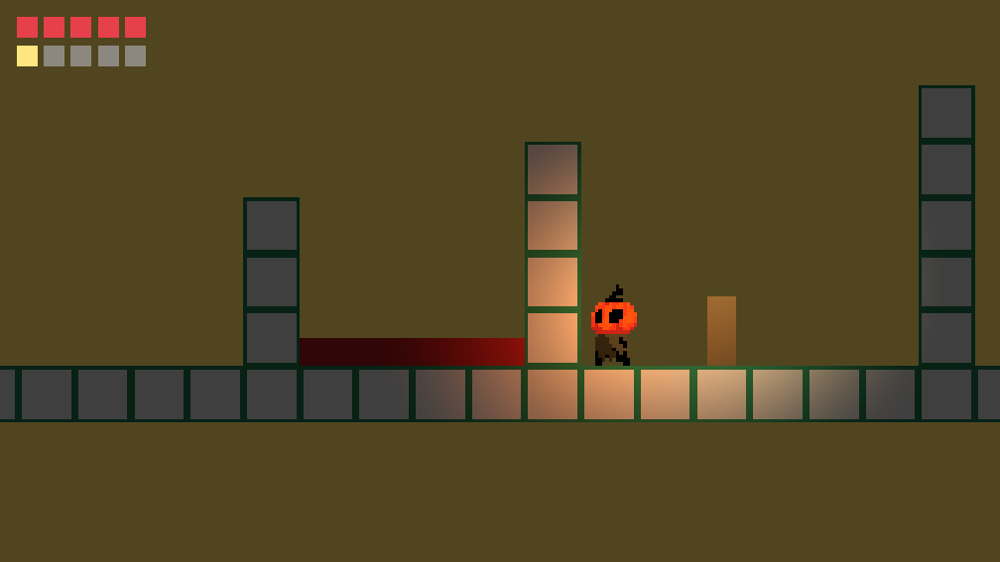

# Playtest 01 · 2026-11-22

**Testador:** o autor, na cena `MetricsTest` · **Build:** editor, antes do blockout das áreas
**Objetivo do teste:** validar as peças do blockout (lamparina, espinhos, água tóxica, vela, pergaminho, HUD) e o retorno ao chão seguro.

## Observações

- Lamparina, vela, pergaminho e HUD funcionaram como esperado.
- A luz da cabeça do Jack aparece pouco.
- O retorno ao chão seguro às vezes colocava o Jack **na quina** de uma plataforma.
- Às vezes o ponto salvo ficava **em cima dos espinhos**, porque havia chão firme por baixo deles. Isso acontecia durante a invulnerabilidade: o Jack andava sobre os espinhos sem tomar dano, e a posição era salva ali.

## O teste mostrou → então mudei

| Observação | Mudança |
| --- | --- |
| Ponto salvo na quina da plataforma | O ponto salvo é **deslocado para meio tile longe das bordas**; em plataformas estreitas, vai para o **centro**. Tentativas anteriores: exigir meio tile além de cada pé (impedia salvar em plataformas de 1 tile) e só exigir os dois pés apoiados (o ponto voltava a ficar perto da quina) |
| Ponto salvo em cima dos espinhos | Só salva a **meio tile de distância de qualquer armadilha**, que agora ficam numa camada própria (`Hazard`). A primeira tentativa usou 1 tile, mas impedia salvar em plataformas de 1 tile entre armadilhas |
| Ponto salvo durante a invulnerabilidade | Não salva enquanto o Jack está invulnerável |
| Luz da cabeça pouco visível | Pendente: ajustar luz global, intensidade e raio no blockout |
